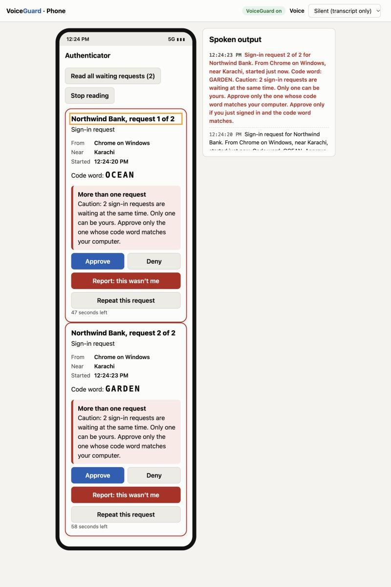
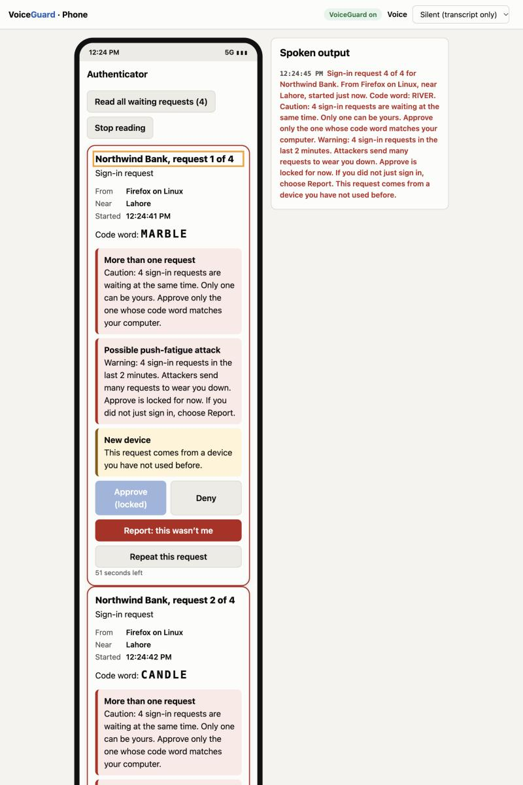

**Course:** Human-Computer Interaction, IBA, Fall 2026

**Paper extended:** Akanda, Mahdad, Saxena. *Broken Access: On the Challenges of Screen Reader Assisted Two-Factor and Passwordless Authentication.* ACM Web Conference (WWW '25), Sydney, Australia.

| Name | Roll No. |
|---|---|
| Qazi Muhammad Waiz | 28982 |
| Haris Shibli | 28988 |
| Abdullah Feroz | 29219 |

# Summary

*Broken Access* showed that screen-reader users cannot hear the information they need to stay safe while signing in. Fake domains sound the same as real ones. An attacker's push notification can replace the user's own. Repeated prompts can wear a user down until they approve. The paper suggests fixes in one paragraph but never builds or tests them.

We built **VoiceGuard**, a screen-reader-aware security layer that implements and extends those fixes, and evaluated it. VoiceGuard works through what is *spoken* to the user:

- It says **exactly how a fake domain differs** from the real one, letter by letter in the NATO alphabet.
- It **never lets one push hide another**, and links each push to the user's own sign-in with a **spoken code word**.
- It **detects push spam and locks approval**.
- It **gives users enough time to listen** before a request expires.

**Our contributions are:**

1. **The system:** VoiceGuard and a complete simulation and study environment (simulated computer and phone, attacker console, experimenter console).
2. **An automated evaluation** using the paper's own similarity metric. VoiceGuard detected **99.6%** of 1,114 generated fake domains with **no false alarms** on 85 real sites. The paper's example pair `bankofamerica.com` / `bankoffamerica.com` sounds **100% identical** today and **60% similar** with VoiceGuard. In every simulated concurrent-login race, today's behaviour leaves only the attacker's push on the phone; VoiceGuard shows both, warns, and still tells them apart when the attacker copies the victim's device and city.
3. **An ablation** that switches off each protection in turn. It shows that the **code word** is the only thing that separates the two pushes when the device is spoofed, and that the **fatigue lock** is the only thing that stops approval under spam.
4. **End-to-end sessions in a real browser**, driven keyboard-only by a scripted user, once per condition. Attacks succeeded **3 of 4** times with today's behaviour and **0 of 4** with VoiceGuard, and both legitimate sign-ins still succeeded. These are engineering checks, not a user study.
5. **A pilot session with one blind screen-reader user** (Baseline block only). The participant approved an attacker's push by voice after six spam requests, and could not complete a normal sign-in in 10 minutes. The VoiceGuard block was not reached, so the pilot shows the attacks are real for a screen-reader user but cannot show that VoiceGuard helps people.

The similarity scores in contribution 2 come from a model of speech, not recordings of real screen readers. The pilot was run with verbal informed consent; no formal ethics approval was obtained (see Section 6.3).

# 1. Background

Web services now protect accounts with two-factor and passwordless sign-in: one-time codes, push notifications and FIDO security keys. About 43 million people are blind and 295 million have moderate-to-severe visual impairment. They use these systems through **screen readers** such as NVDA, JAWS, VoiceOver and TalkBack, which turn the screen into speech.

*Broken Access* introduced **AWARE**, a semi-automated framework for checking authentication with screen readers. It has four steps:

1. Record what the screen reader says.
2. Transcribe it and score how clearly the original information survives, using TF-IDF cosine similarity.
3. Simulate attacks.
4. Fix the problems and run AWARE again.

The study covered six screen readers and twelve authentication methods. Every deployed method had an accessibility gap, a security gap, or both.

Our earlier report chose three of the paper's threats to work on: **phishing**, **concurrent login** and **notification fatigue**.

# 2. The problems

## 2.1 Phishing

- Screen readers read the name in a domain as a whole word, so small spelling tricks disappear. The paper measured `bankofamerica.com` against `bankoffamerica.com`, and `wellsfargo.com` against `wellssfargo.com`, and found **100% similarity**. The listener has no audible way to tell them apart.
- Browser phishing warnings are also poorly read out.
- The only fallback is checking the address letter by letter, which is slow and easy to defeat with long or complicated addresses.

## 2.2 Concurrent login

The attacker starts a sign-in at the same moment as the victim and hopes the victim approves the attacker's push instead of their own. The paper found:

- **Google Push** on VoiceOver and TalkBack: the attacker's notification **replaces** the victim's.
- **Duo Push** replaces the victim's notification and shows **no device details**, so the two requests are identical.
- **Microsoft's number-matching prompt** is safer, but a known technique can block it and present malicious options, with no screen-reader warning.
- Prior work found only **5%** of users noticed a concurrent-login attack.
- Device and city details do not help much, because attackers can copy them.

## 2.3 Notification fatigue

The attacker sends push after push until the user gives in. The paper found:

- **Google Push on VoiceOver:** after a denial, the victim is sent to a "change password" step, which they can confuse with the next attacker push.
- **Google Push on TalkBack:** the newest notification replaces the previous one.
- **Microsoft:** after one denial, later prompts become a simple approve/deny that is easy to spam.
- **Duo:** protected only if an administrator has capped the number of attempts.

## 2.4 One shared cause: time

The paper also found that comprehension collapses at faster speech rates: 37% at the default rate, 18% at 60%, and 0% at 80% or above. Deployed services still use fixed expiry windows that ignore how long it takes to *hear* a request.

# 3. Our solution: VoiceGuard

## 3.1 Design idea and name

All three attacks exploit the **voice channel**: what the screen reader says, when it says it, and what it leaves out. VoiceGuard therefore fixes the spoken experience. Visual cues are kept, but every protection is designed to be **heard** first. The paper recommended three things: phishing detection inside the screen reader, announcing the service name, and a detector for repeated notifications. We turned each into a concrete, testable mechanism.

Following our report's advice, we treat concurrent login and fatigue as **one push-abuse track**. A single *push guard* handles both, alongside a *domain guard* for phishing.

## 3.2 HCI principles applied

| Principle (course topic) | Where VoiceGuard applies it |
|---|---|
| Visibility of system status | Every waiting request stays listed and is counted ("request 1 of 2"). The real domain is announced on every page load. |
| Error prevention | Fake sites are blocked before loading. Approve is locked during push spam. |
| Feedback | A warning tone plus a spoken warning. Each decision is confirmed ("Approved", "Reported"). |
| Match with the user's mental model | Users expect a push to be *theirs*. The code word ties each push to the sign-in they just started. |
| Recognition rather than recall | Instead of making the user remember and compare a whole spelling, VoiceGuard names the real site and the exact difference. |
| Accessibility of time | Expiry windows adapt to how long the request takes to speak. |

## 3.3 Solving Problem 1: Phishing (the domain guard)

**What it does.** Whenever a link gets focus or a page loads, the domain guard asks two questions: *is this really the site it looks like?* and *if not, how do we say the difference out loud?*

**How it works.**

1. **Take the address apart.** Find the part of the domain that actually owns the site. In `northwindbank.com.secure-login.net`, that is `secure-login.net`. Country endings such as `.com.pk` are handled. Text before an `@` is treated as fake, as in `paypal.com@evil.net`. Punycode addresses (`xn--…`) are decoded so foreign look-alike letters are visible.
2. **Compare with the user's trusted sites** using nine checks:

| Trick | Example | Detected by |
|---|---|---|
| Doubled letter | `bankoffamerica.com` | Collapsing repeated letters gives the trusted name |
| Missing letter | `gogle.com` | Edit-distance algorithm |
| Swapped letters | `googel.com` | Edit-distance algorithm |
| Replaced letter | `goofle.com` | Edit-distance algorithm |
| Look-alike characters | `paypa1.com`, `rnicrosoft.com` | Mapping `1`→l, `rn`→m and so on gives the trusted name |
| Foreign letters | `pаypal.com` (Cyrillic а) | Unicode look-alike table |
| Different ending | `paypal.net` | Same name, different ending |
| Extra words | `paypal-login.com` | Trusted name plus extra words |
| Brand in subdomain | `paypal.com.secure-login.net` | Trusted name appears only in the subdomain |

3. **Say only the difference**, using the NATO alphabet so letters cannot be misheard:

| Fake domain | Screen reader today | VoiceGuard |
|---|---|---|
| `bankoffamerica.com` | "bankoffamerica dot com" | "Warning! Look-alike link. It goes to bankoffamerica dot com, not bankofamerica dot com. It has a double F, as in Foxtrot, after N, K, O. This is likely a phishing site." |
| `paypa1.com` | "paypa1 dot com" | "…It uses digit one in place of the letter L." |
| `pаypal.com` (Cyrillic) | "paypal dot com" | "…It uses a foreign character that looks like A." |
| `paypal.com.secure-login.net` | "paypal dot com dot secure dash login dot net" | "…The name paypal is only put at the front of the address to trick you." |

4. **Act on it.**
   - When a link gets focus, VoiceGuard speaks the warning and plays an alarm tone.
   - When a page loads, it announces the real domain ("Verified site: northwindbank dot com"), as the paper recommends.
   - Before a fake page loads, an accessible **blocking dialog** appears with keyboard focus on "Go back to safety" (Figure 1).

**Why this is better than spelling.** Spelling the whole address still leaves the user to compare it from memory against the real one. VoiceGuard does the comparison and tells the user which real site was copied and how.

## 3.4 Solving Problem 2: Concurrent login (the push guard)

1. **No override.** Every pending request stays on the phone and is counted. The attacker's push can no longer replace the user's.
2. **Context in speech.** Each push is spoken in full: *"Sign-in request 2 of 2 for Northwind Bank. From Chrome on Windows, near Karachi, started just now."*
3. **Spoken code word.** When the user signs in, the computer says *"Your code word is FALCON. Only approve a request that says FALCON."* Each push speaks its own word, so the attacker's request says something else, such as *"BRIDGE"*. The paper notes that attackers can copy device and city. They cannot know the code word, so it still separates the two requests when everything else matches (Figure 2).
4. **Concurrency alert.** *"Caution: 2 sign-in requests are waiting at the same time. Only one can be yours. Approve only the one whose code word matches your computer."* Requests from an unfamiliar device are also flagged.
5. **Report button.** Every push can be reported as "this wasn't me".
6. **Nothing is missed by ear.** When several requests arrive, each one is read in full, oldest first, instead of the newest cutting off the previous one. Every request has its own heading so screen-reader users can jump between them, and **Read all waiting requests**, **Repeat this request** and **Stop reading** let the user hear them again. Focus moves to the new request's heading, never straight onto Approve, so one accidental tap cannot approve a request the user has not heard.

## 3.5 Solving Problem 3: Notification fatigue (the push guard)

1. **Detection rules.** Spam is assumed when **3 or more requests arrive within 2 minutes** (fast spam) or **2 or more are refused or missed within 10 minutes** (slower spam).
2. **Approval lock.** When spam is detected, Approve is locked for 5 minutes and the reason is spoken: *"Attackers send many requests to wear you down. Approve is locked for now. If you did not just sign in, choose Report."* The server enforces the lock as well, so it cannot be bypassed from the screen (Figure 3).
3. **No confusing follow-up step.** Pushes are never mixed with a "change password" prompt in the same place.

## 3.6 Shared fix: adaptive expiry

Each request's expiry window is set to the time needed to hear it **twice plus 30 seconds**, and never less than the usual 60 seconds. A *"15 seconds left"* warning is spoken. At the default rate, VoiceGuard's announcement takes about 19 s, which gives a 68 s window. At a slower rate (0.75×) the window grows to 81 s.

## 3.7 Voice answers on the phone

The phone can be answered by voice, so the user does not have to find the right button.

- **Automatic listening.** After a request has been read, the phone beeps and listens. A 🎤 **Answer by voice** button stays as a fallback, and a **Listen automatically** checkbox turns it off.
- **What to say.** With VoiceGuard on, the user approves by saying **"approve" plus the code word** ("approve falcon"); "yes" alone is refused with a prompt to say the word, so the spoken answer itself is the code-word check. "Deny" and "report" (or "it's not me") act on the request. In Baseline, "yes" and "no" work. The phone repeats what it heard: *"I heard: approve falcon. Approved."*
- **Not hearing itself.** The announcements contain the word "approve", so the phone listens only after its own speech has ended and ignores any phrase that repeats five or more words it just said.
- **Unique code words.** No two waiting requests share a code word, so a spoken word always points at one request.
- **HTTPS.** Browsers only allow the microphone on HTTPS pages, so the server also serves the app over HTTPS when a certificate is present. Recognition uses the browser's built-in speech service (Google's in Chrome, Apple's in Safari).
- Every voice answer is logged (`voice_listen`, `voice_command`, `voice_error`) for analysis.

# 4. What we built

## 4.1 The application

VoiceGuard is a web application with no dependencies (Node.js 18 or newer). Start it with `npm start` inside `VoiceGuard/`. It simulates the paper's **PC + smartphone** setting, which 49.2% of screen-reader users work in.

| Page | Purpose |
|---|---|
| Computer (`pc.html`) | A simulated browser with an address bar, mail inbox, bank and payment sign-in, and a fake clone of the bank. A panel shows everything that was spoken. |
| Phone (`phone.html`) | A push-approval app. It can also be opened on a **real phone** on the same Wi-Fi, where VoiceOver or TalkBack read it. |
| Attacker console (`attacker.html`) | Sends phishing emails using any of the nine tricks (with a preview of how they sound today and with VoiceGuard), arms a concurrent-login race, and sends push spam. |
| Experimenter (`study.html`) | Runs study sessions (Section 4.2). |
| Results (`results.html`) | Shows the automated evaluation and the study results, comparing baseline and VoiceGuard. |

**Two conditions.**

- **Baseline** reproduces today's behaviour as reported in the paper: domains read as whole words, the newest push replacing the older one, no device details, and a "change password" prompt after a denial.
- **VoiceGuard** turns on the protections.

**Voice modes.** VoiceGuard can speak with a built-in voice, send text to the participant's **own screen reader** through ARIA live regions, do both, or stay silent.

**Realism.** If a participant types a password into a fake page, the server immediately starts an attacker sign-in that sends a push to the phone. This is how real-time phishing kits work, so the phishing and push defences interact as they would in real life. Only fictional brands are used (Northwind Bank, Contoso Pay, Fabrikam Bank, Tailspin Pay), with a study password.

## 4.2 The experimenter console

The experimenter page runs a user study from start to finish.

- **Participant and block.**
  - Enter an ID (P01, P02, …) and choose block 1 or 2.
  - The page counterbalances automatically: odd IDs do baseline first, even IDs do VoiceGuard first.
  - Block 1 always uses brand set A and block 2 uses brand set B, so the same fake emails are never seen twice.
- **Six scripted tasks per block**, in a random but reproducible order for each participant:
  - two legitimate sign-ins
  - two phishing emails: a doubled letter and a brand in the subdomain
  - one concurrent-login race
  - one push-spam attack
- **Running a task.**
  - Pressing Start resets both devices and sets up the scenario, such as delivering an email or arming the attacker.
  - The experimenter can read the instruction aloud, watch a timer against a suggested time limit, and type observer notes.
  - Pressing **End task and score** grades the task automatically from the event log: attack succeeded or resisted, what the participant did, how long they took to decide, how many warnings they heard, whether they reported the attack, and how many spam pushes came before an approval.
- **Questionnaires** after each block:
  - System Usability Scale, scored 0–100 automatically
  - NASA-TLX workload
  - a trust rating
  - interview notes
- **Advanced settings.**
  - Force a condition.
  - Change the speech rate.
  - Switch individual protections on or off (domain warning, page announcement, blocking page, push context, code word, concurrency alert, fatigue lock, adaptive expiry). This supports the ablation in Section 5.3.
- **Export.** Download results, the full event log and the questionnaires as CSV files for analysis in Excel, R or SPSS.

## 4.3 Testing

- 17 automated unit tests cover both guards, and all pass.
- We tested every scenario in the browser in both conditions:
  - In baseline, the phishing link opened the fake bank and the attacker's relay push was approved. This was scored as attack success.
  - With VoiceGuard, the link was blocked and scored as resisted.
  - In the concurrent race, both pushes were shown with different code words. The tester approved their own and reported the attacker's.
  - Under spam, Approve locked at the third push.

# 5. Findings: automated evaluation

Like AWARE, we evaluated VoiceGuard automatically before involving participants. Run `npm run eval`. Results are saved in `VoiceGuard/eval/results/`.

**How "what the listener hears" is measured.** We did not record real screen readers. Instead, the evaluation **models** the speech: the *baseline* is the domain rendered as a screen reader reads it (labels as whole words, "dot" between them), and *VoiceGuard* is our announcement text. Both are phonetically normalised so that spellings a speech engine pronounces alike match (doubled letters, c/k, ph/f, Unicode look-alikes), and then compared with TF-IDF cosine similarity over character trigrams, the paper's metric. The similarity numbers below are therefore estimates of what is heard, not measurements of real screen-reader audio (see Section 8).

## 5.1 Phishing

**Method.**

- We took **50 real, frequently phished brands**, including HBL, Meezan Bank, JazzCash and Easypaisa, and generated up to three fakes per trick, giving **1,114 fake domains**.
- For false alarms we used **85 legitimate sites** that are not on the trusted list.
- For each fake we compared the modelled speech for the real link and for the fake one, today and with VoiceGuard.

| Finding | Result |
|---|---|
| Fakes detected, with the correct real site named | **99.6%** (1,110 of 1,114) |
| False alarms on legitimate sites | **0%** (0 of 85) |
| `bankofamerica` / `bankoffamerica`, how similar they sound | **100% today → 60.4% with VoiceGuard** (reproduces the paper's 100%) |
| `wellsfargo` / `wellssfargo` | **100% → 59.4%** |
| Fakes that sound *identical* today | 21.4% overall, including **98%** of doubled-letter and **100%** of foreign-letter fakes |
| Fakes that sound identical with VoiceGuard | **0%** |
| Average similarity, all tricks | 68.8% today → 49.1% with VoiceGuard |
| Listening time | 3.8 s for VoiceGuard's difference sentence vs 5.0 s to spell the whole address |

| Trick | Detected | Sounds identical today | Similarity today | With VoiceGuard |
|---|---|---|---|---|
| Doubled letter | 99.2% | 98.4% | 99.4% | 53.5% |
| Missing letter | 99.2% | 0.8% | 60.7% | 45.5% |
| Swapped letters | 100% | 0% | 46.8% | 45.3% |
| Replaced letter | 98.6% | 0% | 52.9% | 41.7% |
| Look-alike characters | 100% | 0% | 53.1% | 52.7% |
| Foreign letters | 100% | 100% | 100% | 54.5% |
| Different ending | 100% | 0% | 77.9% | 51.3% |
| Extra words | 100% | 0% | 73.1% | 55.5% |
| Brand in subdomain | 100% | 0% | 57.8% | 44.5% |

**What this means.**

- The two tricks that are truly *inaudible* today, doubled letters and foreign letters, are exactly the paper's concern. VoiceGuard detects them and makes them clearly different to the ear.
- Tricks such as swapped letters were already partly audible, which explains their smaller gains. Even there, VoiceGuard adds the most important information: that the site is fake, and which real site it copies.
- The only misses were one-letter changes to the three-letter brand "hbl.com". Very short names are deliberately not checked for one-letter typos, because doing so would cause false alarms.

## 5.2 Concurrent login and fatigue

We replayed attack timings through the push guard. All eight checks passed.

| Check | Result |
|---|---|
| Today: the attacker's push hides the victim's when it arrives second | True for every race tested (0–60 s apart) |
| VoiceGuard warns about concurrent requests | Yes, for every race while the victim's request is still waiting |
| Attacker copies the victim's browser, OS and city | Device details alone can no longer tell the two apart; **the code word still can** |
| Push spam at intervals from 5 s to 5 min | Warning and Approve lock by the **3rd push**, whether the user denies or ignores the pushes |
| Normal single sign-in, or a retry after a timeout | No warning (no false alarm) |
| Expiry leaves time to hear the request twice plus 30 s | Yes, at every speech rate tested |
| Known limit | Very slow spam (one push every 15 minutes) is not detected |

## 5.3 Ablation: what each protection contributes

We switched off one push-guard component at a time and replayed the same scenarios: 7 concurrent-login races (attacker 0–60 s after the victim), with and without a spoofed device; 12 fatigue schedules (one push every 5 s to 5 min, user denies or ignores); expiry at five speech rates; and two normal sign-ins. "Pushes sound different" compares the two spoken announcements after removing the request number and age. Keeping every push visible (no override) is part of the VoiceGuard interface and is not switched off here. Run `node eval/ablation-eval.js`; full output is in `eval/results/ablation_results.md`.

| Configuration | Pushes sound different (spoofed device) | Pushes sound different (other device) | Warned of second request | Approve locked by 3rd spam push | Expiry at 1.0× / 0.75× |
|---|---|---|---|---|---|
| Full VoiceGuard | 7/7 | 7/7 | 7/7 | 12/12 | 68 s / 81 s |
| Without context (device, city) | 7/7 | 7/7 | 7/7 | 12/12 | 62 s / 73 s |
| Without code word | **0/7** | 7/7 | 7/7 | 12/12 | 60 s / 69 s |
| Without concurrency alert | 7/7 | 7/7 | **0/7** | 12/12 | 60 s / 60 s |
| Without fatigue lock | 7/7 | 7/7 | 7/7 | **0/12** | 68 s / 81 s |
| Without adaptive expiry | 7/7 | 7/7 | 7/7 | 12/12 | **60 s / 60 s** |
| Without code word and context | **0/7** | **0/7** | 7/7 | 12/12 | 60 s / 61 s |
| All components off | 0/7 | 0/7 | 0/7 | 0/12 | 60 s / 60 s |

No configuration produced a false alarm on a normal sign-in.

**What this means.**

- **The code word is the only defence against a spoofed device.** Without it, the attacker's request sounds exactly like the user's in every race. Context (device and city) only helps when the attacker does not copy them, and it also drives the "new device" warning.
- **Each other protection does one job that nothing else covers.** Without the concurrency alert the user is never told that two requests are waiting. Without the fatigue lock nothing stops approval under spam (0 of 12 schedules). Without adaptive expiry the window stays at 60 s, which is too short to hear the full request twice at 1.0× (19 s of speech) and 0.75× (25 s).
- **Domain warning.** With the look-alike link warning off, the listener hears the baseline reading of the domain: 21.4% of look-alikes sound identical to the real site and mean similarity rises from 49.1% to 68.8% (Section 5.1).

# 6. End-to-end sessions and pilot with a blind user

## 6.1 Scripted end-to-end sessions

**Purpose.** To check that each mechanism fires in the real interface and that the words a screen-reader user hears are what we claim. **This is an engineering check, not a user study.**

**Method.** A Playwright script drove the unmodified app in Chrome **keyboard-only** (Tab, Enter, typing), once per condition, through the six study tasks with brand set A in the same order. Voice mode was "My screen reader", so announcements went to the ARIA live regions a screen reader reads. Every announcement was captured from the app's spoken-output panel, and the app scored each task itself. The scripted user followed one policy: approve only a request that can be tied to a sign-in just made, and in VoiceGuard only if the code word matches. Full transcripts are in `docs/blind-user-session/`.

**Results.**

| Task | Baseline | VoiceGuard |
|---|---|---|
| legit_email | Signed in | Signed in |
| legit_login | Signed in | Signed in |
| phish_typo | **Attack succeeded**: opened link, typed password, approved relay push | Resisted: went back from warning, reported |
| phish_subdomain | **Attack succeeded**: same pattern | Resisted: went back from warning, reported |
| concurrent | **Attack succeeded**: approved the attacker's push | Resisted: approved own (COFFEE), reported attacker's (RIVER) |
| fatigue | Resisted | Resisted; Approve locked from the 3rd request |

Attacks succeeded **3 of 4** times in Baseline and **0 of 4** with VoiceGuard, and both legitimate sign-ins succeeded in both conditions. In Baseline the fake link was read as "northwiindbank dot com" and the fake page sounded exactly like the real one; with VoiceGuard the user heard *"It has a double I, as in India, after T, H, W."* Baseline fatigue was resisted only because the script denies any request it cannot tie to its own sign-in. Its denial message ("Denied. Secure your account. Change password.") was followed ten seconds later by an identical request in the same place, which would mislead a person.

Recording the sessions also exposed five problems in VoiceGuard's speech; four were fixed and one was kept on purpose (`docs/FIXES.md`).

## 6.2 Pilot with a blind participant

**Participant and setup.** One blind screen-reader user (P01) took part. They used a screen reader on the computer and a phone with its screen reader, connected over a phone hotspot. The protocol was the planned within-subjects design (Baseline and VoiceGuard in counterbalanced blocks, six scripted, auto-scored tasks per block); P01 was assigned Baseline first. They were told the study was about "how easy it is to sign in with a screen reader" and were not warned about attacks. Voice answering (Section 3.7) was added during the session, after the first fatigue task.

**Results.** P01 completed part of the Baseline block. Two tasks gave valid results:

| Task | Outcome | What happened |
|---|---|---|
| fatigue | **Attack succeeded** | After the sixth spam request, P01 pressed the voice button and said *"Yes, I'm trying to sign in"*, 44 s after that request arrived, although they had been told not to sign in |
| legit_login | Sign-in failed | In 10 minutes P01 did not reach the payment app's bookmark; near the end they opened an unrelated email and its link |

Five further attempts were excluded: two phishing attempts interrupted by setup changes (in one, the participant typed the password on the fake site and approved the relay push before the task was stopped), and three concurrent-login attempts in which no attack was delivered, because the sign-in was not completed or the phone page had disconnected. The VoiceGuard block and the questionnaires were not reached. Voice recognition worked on the participant's own phone.

**What the pilot showed.**

- **Push fatigue is real for screen-reader users.** The fatigue result is the failure *Broken Access* describes, observed with a real participant.
- **Logistics, not the protections, cost most of the tasks.** A phone that locked and dropped its connection, campus Wi-Fi that blocked devices from reaching each other, a screen reader not yet switched on, and unfamiliar keyboard navigation. A full study needs the participant's own devices, auto-lock disabled, a private network, and a longer familiarisation.

## 6.3 Consent and ethics

The participant gave verbal informed consent after the study was explained, was told they could stop at any time and withdraw their data, and was not warned about attacks in advance. No formal ethics approval was obtained for this course project; a full study would need it. Only fictional brands and a study password were used. Data are identified only by participant ID and kept out of the project repository. Voice recognition sends audio to the browser's speech service, which a full study must disclose in its consent form.

# 7. Discussion

**What we learned.**

1. The paper's key phishing problem is about **audibility**, not detection. Detection algorithms for fake domains are well understood. What was missing is a way to *say* the result so a listener can act on it. Naming the exact difference with the NATO alphabet turns a 100% audio match into a clearly different message. In the scripted sessions, both phishing attacks succeeded in Baseline and were stopped with VoiceGuard.
2. For push attacks, **interface behaviour matters more than extra information**. Device and city details can be faked, and a newer push can bury an older one. The ablation shows that the code word is the only component that separates the two requests once the device is copied. Whether people compare code words in practice is still untested: the pilot's concurrent-login attempts were lost to setup problems.
3. **Fatigue protection has to act, not only warn.** A warning alone can itself be worn down. Locking approval removes the "give in to make it stop" option; in the ablation, nothing else prevents approval under spam. The pilot participant approved the sixth spam request while saying "Yes, I'm trying to sign in", although they had been told not to sign in. That is exactly the moment the lock is built for.

**Trade-offs.**

- **Longer announcements.** VoiceGuard's warnings are longer (about 10 s for a full link warning and 19 s for a push at the default rate). We put the critical words first ("Warning! Look-alike link") so users can act before the end. The full warning is spoken once per link, with one-line reminders afterwards.
- **False alarms.** Too many warnings would train users to ignore them. We kept a 0% false-alarm rate on the 85 legitimate sites, partly by not checking typos in very short names.
- **Lock-out risk.** A genuine user who denies twice by accident is locked out for 5 minutes. A security key or other sign-in method should remain available.
- **Deployment.** In practice VoiceGuard would need to be split between a screen-reader add-on (domain warnings) and the service provider (no-override pushes and code words). Our prototype shows the user experience, not that deployment.

# 8. Limitations

- **One human participant, one condition.** The pilot gave two valid Baseline tasks from one blind participant, and the VoiceGuard block was not reached. It shows the attacks are real for a screen-reader user, but it cannot show that VoiceGuard helps people. A within-subjects study with 20 participants, as in our plan, is needed.
- **The end-to-end sessions use a scripted user.** They confirm that each mechanism fires and that the wording is what we claim. They cannot show whether a person understands the NATO spelling or compares code words in their head, and their timings are machine timings.
- **Voice answering is new and partly tested.** A pressed-button voice answer worked on a real phone. Automatic listening and its echo filter were tested only with simulated recognition results.
- **No separate pilot of the protocol.** No blindfolded pilot data was recorded, and the session with the blind participant had to serve as one.
- **High attack base rate.** Four of six tasks per block were attacks, far more than in real life, and a participant may become more alert after the first attack. Results show whether attacks *can* be detected, not how often they would be in daily use.
- **Modelled speech, not real screen readers.** The similarity scores in Section 5 come from a model of what a screen reader says, not from recordings of NVDA, JAWS, VoiceOver or TalkBack. The planned replication with real screen-reader audio (Phase 1b of our plan) was not carried out.
- **Short brand names.** All four phishing misses were one-letter changes to the three-letter brand "hbl.com" (`hbbl`, `hl`, `hvl`, `hnl`). Names of three letters or fewer are deliberately not checked for single-letter typos, to avoid false alarms, so such fakes get no warning.
- **Very slow push spam.** One push every 15 minutes or more is not detected by the fatigue rules.
- **A copied device defeats context details.** When the attacker copies the victim's browser, OS and city, the spoken context no longer helps; only the code word separates the requests, and it only works if the user compares it.
- **Lock-out trade-off.** The fatigue lock also blocks a genuine user who denies twice by mistake, for 5 minutes.
- **No formal ethics approval.** The study relied on verbal informed consent and a debrief.
- **Speech only.** Like the paper, we study speech output, not braille displays.

# 9. Conclusion

*Broken Access* showed that sign-in security fails screen-reader users through the audio channel. VoiceGuard shows that this can be fixed:

- Say exactly how a fake site differs from the real one.
- Never let one push hide another.
- Tie each push to the user's own sign-in with a spoken code word.
- Stop push spam by acting on it, not only warning about it.
- Give users enough time to listen.

Our automated evaluation reproduces the paper's 100% similarity finding and shows VoiceGuard removing it: it detects 99.6% of fake domains with no false alarms and defends against concurrent-login and fatigue attacks in every simulated case. The ablation shows that each protection covers a distinct gap, with the spoken code word as the only defence once an attacker copies the victim's device. In keyboard-only end-to-end sessions, VoiceGuard stopped every attack that succeeded under today's behaviour, without blocking normal sign-ins. A pilot with a blind participant confirmed that push fatigue works on real screen-reader users. A study with blind and visually impaired participants, and a replication with real screen-reader recordings, are needed to show that VoiceGuard helps people in practice.

# Appendix A: Answers to our discussion questions

**Q9. Phishing: which design principle fails, and how would we redesign it?** The failure is **visibility**, together with **error prevention**. The critical information (a spelling difference) is visible on screen but invisible in audio. Our redesign announces the real domain on every page, names the exact difference in the NATO alphabet, and blocks the fake page before it loads.

**Q10. Concurrent login: why can the attacker's push be approved, and how should it be fixed?** The newest push replaces the older one, and the interface gives no **feedback** that two requests exist. It also offers nothing that matches the user's **mental model** that "this push is mine". The fix keeps every request visible and counted, speaks the requesting device, and ties each push to the user's sign-in with a code word spoken on both devices.

**Q11. How would we measure notification fatigue?**

- **Independent variable:** condition (baseline vs VoiceGuard), within subjects and counterbalanced.
- **Dependent variables:** whether any spam push is approved, how many pushes come before approval, decision time, and NASA-TLX frustration.
- **Assignment:** odd and even participant IDs give AB/BA order. The experimenter page does this automatically.

**Q12. A study of one mitigation (announcing service and device name).**

- **Participants:** screen-reader users (20 planned; one took part in our pilot).
- **Measures:** approval rate of concurrent attacker pushes and decision time.
- **Analysis:** McNemar's test on paired outcomes, plus an ablation using the component switches (context announcement on vs off, code word on vs off; Section 5.3).
- **Ethics:** accessible consent, deception kept to the minimum with a full debrief, no real credentials, and anonymised data.

# Appendix B: Running the application and analysis

1. Install Node.js 18 or newer.
2. In the `VoiceGuard` folder, run `npm start` and open `http://localhost:3000`.
3. Open the **Computer** and **Phone** pages and press Start on each.
4. Use the **Attacker** page to run attacks. On the **Experimenter** page, open Advanced to switch between Baseline and VoiceGuard.
5. Run `npm test` for the unit tests and `npm run eval` to regenerate the automated evaluation and the ablation.
6. After a study, run `node eval/study-analysis.js data/study` to produce `eval/results/study_results.md`.

# Appendix C: Changes from the experimental plan

| Planned | What we did |
|---|---|
| 20 blind and visually impaired participants (minimum 12) | One blind participant, Baseline block only, reported as a pilot; plus scripted keyboard-only sessions in both conditions |
| 75-minute sessions | One partial session |
| IBA ethics approval before recruiting | Verbal informed consent and debrief; no formal approval |
| Phase 1b: recordings of real screen readers | Not carried out; similarity scores use modelled speech |
| Phase 2: blindfolded pilot with 6–8 people | Not recorded |
| Ablation in Phase 1 | Done for the push guard (Section 5.3) |
| Button-only answers on the phone | Voice answers added during the pilot (Section 3.7) |
